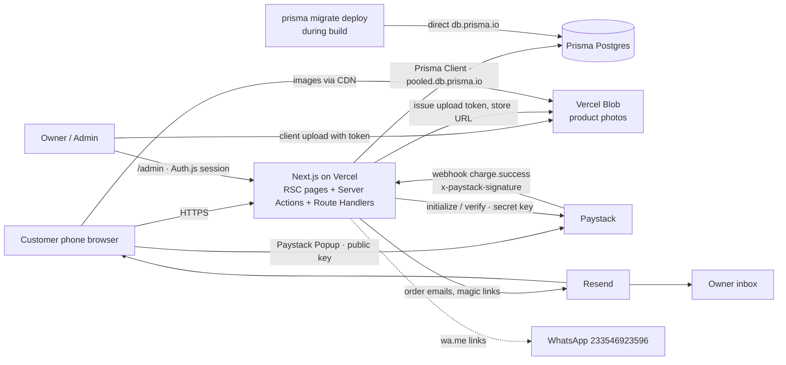
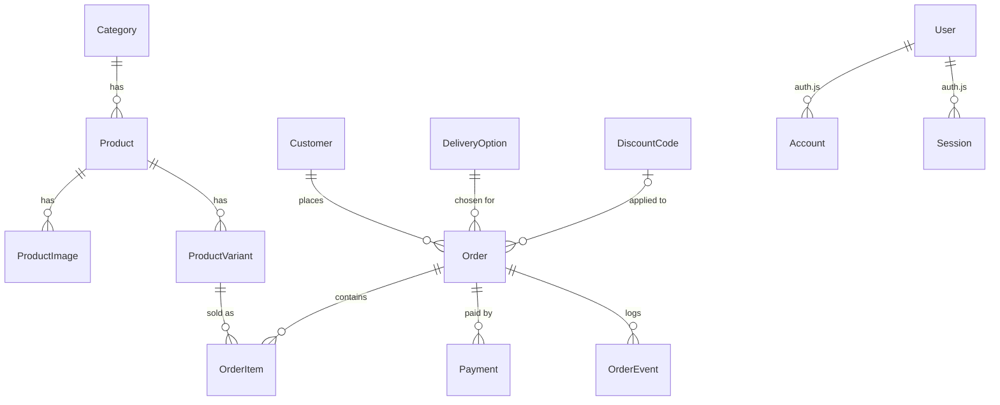
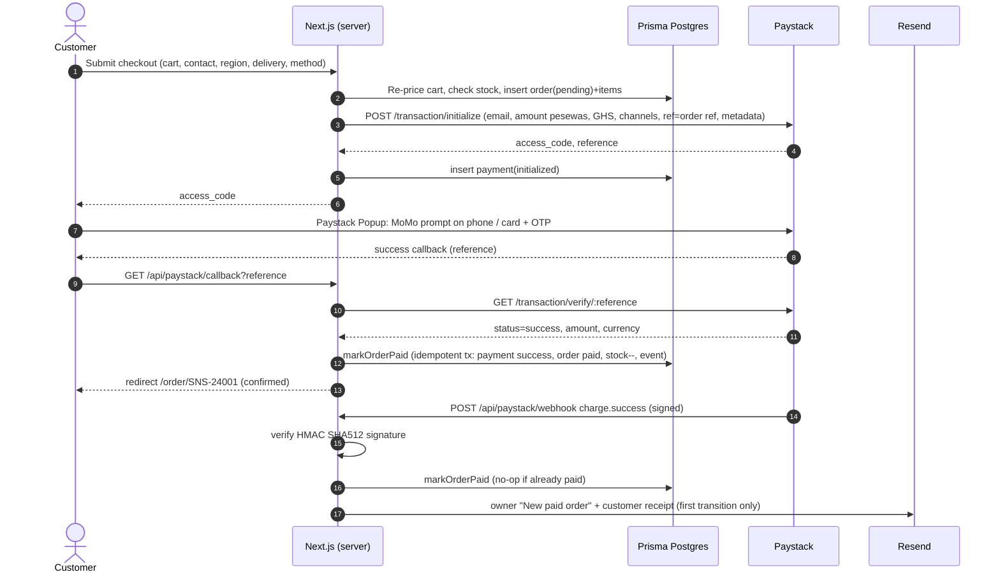

# SN Stitches — System Design

**Brand:** SN Stitches — *Fashion • Design • Stitch* · Accra, Ghana
**Contact:** Instagram [@sn_stitches_](https://instagram.com/sn_stitches_) · TikTok [@sn_stitches](https://www.tiktok.com/@sn_stitches) · Phone/WhatsApp 054 692 3596 (`233546923596`)
**Market:** mostly Ghana, prices in Ghana cedis (GH₵ / GHS), payments by Mobile Money (MTN, Telecel, AirtelTigo) and card.
**Visual design (source of truth for UI):** high-fidelity mockups in `ui-design/` (`screens/desktop`, `screens/mobile`, `SN-Stitches-UI-Design.pdf`) + `UI_SPEC.md`. `reference-prototype/` is an older functional prototype kept only for flows and copy.
**Deployment:** Richard deploys to Vercel himself (§14a). The build agent must not deploy.

Legend: **[P1]** = Phase 1 / MVP · **[P2]** = later · **[P3]** = nice-to-have

---

## 1. Goals & constraints
- Sell ~10–200 dresses (sizes XS–XXL, a few colours each) to customers on mobile phones, often on slow or expensive mobile data.
- Payments must be **verified on the server** (Paystack), never trusted from the browser.
- One owner/admin (maybe 1–2 staff) manages products, stock and orders from a phone.
- Running costs close to **GH₵0/month** at launch (free tiers). Simple enough for one freelance developer to maintain.

## 2. Recommended stack (and why)
| Layer | Choice | Why |
|---|---|---|
| Framework | **Next.js 15 (App Router) + TypeScript** | Server Components give small JS bundles (good on mobile data). Server Actions and Route Handlers mean there's no separate backend. Strong SEO support. First-class on Vercel. |
| Styling | **Tailwind CSS v4** + headless primitives (Radix / shadcn/ui) | Tokens live in one config. Primitives are accessible. The "Atelier" signature styles (UI_SPEC §0) are custom CSS utilities. |
| Database | **Prisma Postgres** (managed Postgres by Prisma) | Free plan, no credit card. Built-in managed connection pool (PgBouncer) that suits serverless functions. One vendor for the DB and the ORM. |
| ORM / migrations | **Prisma ORM** (current major) | Type-safe queries, `prisma migrate` for versioned migrations, `prisma db seed`, Prisma Studio for quick data fixes. |
| Admin auth | **Auth.js (NextAuth v5)** + `@auth/prisma-adapter` | Email magic link (via Resend) and/or credentials (argon2/bcrypt hash). Sessions stored in Postgres. A `role` field on `User` gates the admin. |
| Images | **Vercel Blob** (public store) | Admin uploads straight from the product editor (client upload with a server-issued token). Served from the CDN. Optimised with `next/image`. |
| Payments | **Paystack** (Popup/Inline + Transactions API + webhooks) | Ghana-native. GHS, MoMo (MTN, Telecel, AirtelTigo) and cards. |
| Email | **Resend** + React Email | Owner notifications, customer receipts and Auth.js magic links. |
| Hosting | **Vercel** | Zero-config Next.js, preview deploys, Blob and Analytics built in. **Richard deploys it himself. The build agent never deploys.** |
| Validation | **Zod** | One schema shared by forms and server actions. |
| Cart state | Zustand + `persist` (localStorage) | Instant, works offline, no DB operations spent on browsing. |
| Testing | Vitest (unit), Playwright (e2e) | Protects checkout and payment logic. |

**Free-tier facts** (checked on the vendors' pages on 29 Oct 2026; re-check before launch):
- **Prisma Postgres Free:** $0, no card. **200,000 operations / month** (each ORM query = 1 operation) shared across the workspace. Up to 50 databases. **10 pooled + 10 direct connections** (5 direct are reserved for the platform). **No automated backups** on Free. When the operation limit is reached, queries are **blocked until the next calendar month** (one-time 24h grace) unless you upgrade. Free storage is listed as 500 MB on the pricing page and 2 GB in the docs, so confirm in the console. Starter is $10/month (1M operations, 10 GB, daily backups).
- **Vercel Blob (Hobby):** 1 GB storage, 10K simple operations (cache-miss reads), 2K advanced operations (uploads/lists) and 10 GB data transfer per month. Access is paused (not billed) if a limit is exceeded.
- **Vercel Hobby is for non-commercial, personal use** under Vercel's fair-use terms. A live shop taking payments should move to **Vercel Pro (about $20/month)** at launch. Hobby is fine for previews.

**Keeping within 200k operations/month:** catalogue pages are statically generated / ISR with `revalidateTag('products')` on admin save, so browsing makes almost no DB queries. The cart lives on the device. Checkout uses about 10–15 operations per order. Avoid polling loops (the confirmation poll is capped at 20 calls). Add `npx prisma postgres usage` / console checks to the go-live checklist. Upgrade to Starter if traffic grows.

**Rejected for now:** Shopify (monthly USD fees, weaker MoMo/GHS fit), Supabase (replaced at Richard's request by Prisma Postgres), a custom Node API.

## 3. Architecture


## 4. Data model (Prisma Postgres)
Money is **Int pesewas** everywhere (GH₵450.00 = `45000`). IDs are `cuid()`. Timestamps use `@default(now())` / `@updatedAt`.



### `prisma/schema.prisma` (draft)
```prisma
// SN Stitches: Prisma schema draft. Money = Int pesewas.
// Runtime traffic uses the POOLED url (pooled.db.prisma.io); CLI/migrations use the DIRECT url (db.prisma.io).
// Follow the current Prisma ORM docs for where the URLs live (schema datasource vs prisma.config.ts)
// and whether a driver adapter (e.g. @prisma/adapter-pg) is required in your Prisma major version.

generator client {
  provider = "prisma-client-js"
}

datasource db {
  provider  = "postgresql"
  url       = env("DATABASE_URL")   // pooled
  directUrl = env("DIRECT_URL")     // direct, for migrate/studio
}

enum Role            { CUSTOMER STAFF OWNER }
enum ProductStatus   { DRAFT ACTIVE ARCHIVED }
enum DressLength     { MINI MIDI MAXI PLAYSUIT }
enum Size            { XS S M L XL XXL }
enum OrderStatus     { PENDING PAID PROCESSING SHIPPED DELIVERED CANCELLED REFUNDED }
enum PaymentMethod   { MOMO CARD WHATSAPP }
enum PaymentChannel  { MOBILE_MONEY CARD OTHER }
enum PaymentStatus   { INITIALIZED SUCCESS FAILED ABANDONED }
enum MomoNetwork     { MTN TELECEL AIRTELTIGO }
enum DiscountType    { PERCENT FIXED }
enum GhanaRegion {
  GREATER_ACCRA ASHANTI CENTRAL EASTERN WESTERN WESTERN_NORTH VOLTA OTI
  NORTHERN SAVANNAH NORTH_EAST UPPER_EAST UPPER_WEST BONO BONO_EAST AHAFO
}

model Category {
  id          String    @id @default(cuid())
  name        String
  slug        String    @unique
  description String?
  imageUrl    String?
  sortOrder   Int       @default(0)
  isActive    Boolean   @default(true)
  products    Product[]
  createdAt   DateTime  @default(now())
  updatedAt   DateTime  @updatedAt
}

model Product {
  id               String           @id @default(cuid())
  name             String
  slug             String           @unique
  description      String
  details          String[]
  length           DressLength
  pricePesewas     Int
  compareAtPesewas Int?
  status           ProductStatus    @default(DRAFT)
  isFeatured       Boolean          @default(false)
  madeToMeasure    Boolean          @default(false)
  mtmFeePesewas    Int?             // e.g. 8000 = GH₵80
  leadTimeDays     Int?
  seoTitle         String?
  seoDescription   String?
  isSample         Boolean          @default(false) // seed data marker
  categoryId       String
  category         Category         @relation(fields: [categoryId], references: [id])
  images           ProductImage[]
  variants         ProductVariant[]
  orderItems       OrderItem[]
  createdAt        DateTime         @default(now())
  updatedAt        DateTime         @updatedAt
  @@index([status, isFeatured])
  @@index([categoryId])
}

model ProductImage {
  id        String  @id @default(cuid())
  productId String
  product   Product @relation(fields: [productId], references: [id], onDelete: Cascade)
  url       String  // Vercel Blob public URL
  pathname  String  // Blob pathname (for delete)
  alt       String
  width     Int?
  height    Int?
  sortOrder Int     @default(0) // 0 = main, 1 = hover image
  @@index([productId, sortOrder])
}

model ProductVariant {
  id                   String      @id @default(cuid())
  productId            String
  product              Product     @relation(fields: [productId], references: [id], onDelete: Cascade)
  size                 Size
  colourName           String
  colourHex            String?
  sku                  String      @unique
  stockQty             Int         @default(0) // CHECK (stock_qty >= 0) added in SQL migration
  priceOverridePesewas Int?
  isActive             Boolean     @default(true)
  orderItems           OrderItem[]
  @@unique([productId, size, colourName])
}

model Customer {
  id             String   @id @default(cuid())
  fullName       String
  phone          String   @unique // E.164 +233…
  email          String?
  marketingOptIn Boolean  @default(false)
  orders         Order[]
  createdAt      DateTime @default(now())
}

model DeliveryOption {
  id          String   @id @default(cuid())
  code        String   @unique // ACCRA_SAME_DAY, ACCRA_NEXT_DAY, REGIONAL, STUDIO_PICKUP
  label       String
  etaText     String
  feePesewas  Int
  regions     GhanaRegion[] // empty = all regions
  cutoffTime  String?  // "12:00" Africa/Accra
  isPickup    Boolean  @default(false)
  isActive    Boolean  @default(true)
  sortOrder   Int      @default(0)
  orders      Order[]
}

model Order {
  id                 String        @id @default(cuid())
  orderNumber        String        @unique // SNS-24001…
  accessToken        String        @unique @default(cuid()) // for /order/[number]?t=
  status             OrderStatus   @default(PENDING)
  needsAttention     Boolean       @default(false)
  paymentMethod      PaymentMethod
  momoNetwork        MomoNetwork?
  customerId         String
  customer           Customer      @relation(fields: [customerId], references: [id])
  contactName        String
  contactPhone       String
  contactEmail       String
  region             GhanaRegion
  city               String
  gpsAddress         String?
  addressLine        String
  landmark           String?
  deliveryOptionId   String
  deliveryOption     DeliveryOption @relation(fields: [deliveryOptionId], references: [id])
  deliveryFeePesewas Int
  subtotalPesewas    Int
  discountPesewas    Int           @default(0)
  totalPesewas       Int
  discountCodeId     String?
  discountCode       DiscountCode? @relation(fields: [discountCodeId], references: [id])
  notes              String?
  paidAt             DateTime?
  stockCommitted     Boolean       @default(false)
  notifiedAt         DateTime?     // notifications sent once
  utm                Json?
  items              OrderItem[]
  payments           Payment[]
  events             OrderEvent[]
  createdAt          DateTime      @default(now())
  updatedAt          DateTime      @updatedAt
  @@index([status, createdAt])
}

model OrderItem {
  id                String         @id @default(cuid())
  orderId           String
  order             Order          @relation(fields: [orderId], references: [id], onDelete: Cascade)
  productId         String
  product           Product        @relation(fields: [productId], references: [id])
  variantId         String
  variant           ProductVariant @relation(fields: [variantId], references: [id])
  productName       String  // snapshot
  size              Size
  colourName        String
  unitPricePesewas  Int
  qty               Int
  madeToMeasure     Boolean @default(false)
  lineTotalPesewas  Int
}

model Payment {
  id            String         @id @default(cuid())
  orderId       String
  order         Order          @relation(fields: [orderId], references: [id])
  provider      String         @default("paystack")
  reference     String         @unique
  amountPesewas Int
  currency      String         @default("GHS")
  channel       PaymentChannel?
  status        PaymentStatus  @default(INITIALIZED)
  raw           Json?
  verifiedAt    DateTime?
  createdAt     DateTime       @default(now())
}

model OrderEvent {
  id         String       @id @default(cuid())
  orderId    String
  order      Order        @relation(fields: [orderId], references: [id], onDelete: Cascade)
  fromStatus OrderStatus?
  toStatus   OrderStatus?
  note       String?
  actor      String       // "system" | "webhook" | admin email
  createdAt  DateTime     @default(now())
}

model DiscountCode { // Phase 2
  id                 String       @id @default(cuid())
  code               String       @unique
  type               DiscountType
  value              Int          // percent (0–100) or pesewas
  minSubtotalPesewas Int?
  startsAt           DateTime?
  endsAt             DateTime?
  maxUses            Int?
  usedCount          Int          @default(0)
  isActive           Boolean      @default(true)
  orders             Order[]
}

model StoreSettings { // single row, id = "default"
  id                           String  @id @default("default")
  freeDeliveryThresholdPesewas Int     @default(150000)
  whatsappNumber               String  @default("233546923596")
  contactPhone                 String  @default("0546923596")
  instagram                    String  @default("sn_stitches_")
  tiktok                       String  @default("sn_stitches")
  contactEmail                 String?
  announcementText             String?
}

// ---------- Auth.js (NextAuth v5) Prisma adapter models ----------
model User {
  id            String    @id @default(cuid())
  name          String?
  email         String    @unique
  emailVerified DateTime?
  image         String?
  passwordHash  String?   // only if the credentials provider is enabled
  role          Role      @default(CUSTOMER)
  accounts      Account[]
  sessions      Session[]
  createdAt     DateTime  @default(now())
}
model Account {
  userId            String
  type              String
  provider          String
  providerAccountId String
  refresh_token     String?
  access_token      String?
  expires_at        Int?
  token_type        String?
  scope             String?
  id_token          String?
  session_state     String?
  user              User    @relation(fields: [userId], references: [id], onDelete: Cascade)
  @@id([provider, providerAccountId])
}
model Session {
  sessionToken String   @unique
  userId       String
  expires      DateTime
  user         User     @relation(fields: [userId], references: [id], onDelete: Cascade)
}
model VerificationToken {
  identifier String
  token      String
  expires    DateTime
  @@id([identifier, token])
}
```

**Order status:** `PENDING` → `PAID` → `PROCESSING` → `SHIPPED` (out for delivery / dispatched) → `DELIVERED`. `CANCELLED` is allowed from pending, paid or processing (and restocks). `REFUNDED` is P2. Allowed transitions are enforced in one `canTransition(from,to)` helper.
**Stock** is decremented when the order becomes `PAID`, inside a `prisma.$transaction` using a conditional `updateMany({ where:{ id, stockQty:{ gte: qty } }, data:{ stockQty:{ decrement: qty } } })`. If the count is 0, the order is flagged `needsAttention`.

### Migrations & seed
- `prisma migrate dev --name init` locally. Commit `prisma/migrations/**`. Add a raw-SQL follow-up migration for `CHECK (stock_qty >= 0)` and a sequence for `orderNumber` (`SNS-24001` upward, or a counter row updated in a transaction).
- **Production:** Vercel build command `prisma migrate deploy && next build` (migrations use `DIRECT_URL`). `postinstall: prisma generate`.
- **Seed** (`prisma/seed.ts`, run with `prisma db seed`, idempotent upserts):
  1. Categories (Ankara, Kente, Evening, Casual).
  2. ~12 **sample** products from `reference-prototype/products.js` plus the **Sika Tie-Dye Playsuit**, all `isSample: true`, with variants XS–XXL (stock 0–8, at least one sold-out size).
  3. Images: in dev, serve from `/public/sample/*.webp`. With `BLOB_READ_WRITE_TOKEN` set, upload them to Vercel Blob via `put()` and store the URLs.
  4. The 4 delivery options and `StoreSettings`.
  5. An OWNER user from `SEED_ADMIN_EMAIL` (plus a `SEED_ADMIN_PASSWORD` hash if credentials are enabled).

## 5. Server actions & API routes
| Kind | Path / name | Phase | Purpose |
|---|---|---|---|
| RSC page | `/`, `/shop`, `/shop/[category]`, `/product/[slug]`, `/about`, `/contact`, `/size-guide`, `/faq`, `/checkout`, `/order/[orderNumber]` | P1 | storefront (cart is client state) |
| Server action | `validateCart(items)` | P1 | re-prices the cart from the DB and returns availability (never trust client prices) |
| Server action | `getDeliveryOptions(region)` | P1 | options and fees for a region (+ free-over-threshold) |
| Server action | `createOrder(checkoutInput)` | P1 | Zod validate → re-price → create customer, order `pending` and items → Paystack `transaction/initialize` (amount in pesewas, GHS, channels, metadata.order_id, callback_url) → return `{access_code, reference}` (method=whatsapp: return wa.me URL, status stays `pending`) |
| Route handler | `GET /api/paystack/callback?reference=` | P1 | after the popup/redirect: `transaction/verify/:reference` → `markOrderPaid()` (idempotent) → redirect to `/order/[orderNumber]` |
| Route handler | `POST /api/paystack/webhook` | P1 | HMAC-SHA512 signature check (`x-paystack-signature`, secret key) on the raw body → on `charge.success` re-verify the amount and currency against the order → `markOrderPaid()` (idempotent) → 200 quickly |
| Lib (server) | `markOrderPaid(reference, payload)` | P1 | one transaction: payment success, order `paid`, decrement stock, event log; then send notifications (only on the first transition) |
| Route handler | `GET /api/orders/[orderNumber]/status` | P1 | confirmation page polls while status=pending (webhook may land after redirect). Returns status only, keyed by order number + short token |
| Route handler | `POST /api/admin/blob-upload` | P1 | Vercel Blob **client-upload token** route (`handleUpload` from `@vercel/blob/client`). `onBeforeGenerateToken` calls `requireAdmin()` and restricts content types (jpeg/png/webp) and max size (8 MB). `onUploadCompleted` is optional (on localhost, save the URL from the client instead) |
| Server actions (admin) | `upsertProduct`, `archiveProduct`, `addProductImage(url, pathname, alt)`, `deleteProductImage` (Blob `del()`), `reorderImages`, `upsertVariant/adjustStock`, `updateOrderStatus(orderId, to, note)`, `updateSettings`, `upsertDeliveryOption`, `upsertDiscount` [P2] | P1 | **every action starts with `await requireAdmin()`** (Auth.js `auth()` + role OWNER/STAFF) |
| Route handler | `/api/auth/[...nextauth]` | P1 | Auth.js v5 handlers |
| Route handler | `GET /api/admin/orders.csv` | P2 | export |
| Route | `/sitemap.xml`, `/robots.txt`, OG image route | P1 | SEO |

## 6. Payment flow

**Rules:** the amount and currency must equal `orders.total_pesewas`/GHS or the order is flagged. The reference is unique per attempt. If the popup closes, the order stays `pending` and the customer can retry. Pending orders older than 24h are auto-cancelled by a scheduled job [P2] (Vercel Cron), or the owner cancels them manually [P1].
**Demo/dev:** use Paystack **test keys** (`pk_test_`/`sk_test_`). If keys are missing, the UI shows a "Payments not configured" banner and blocks payment. No fake success in production builds. An explicit `NEXT_PUBLIC_DEMO_PAYMENTS=true` may simulate success locally only.

## 7. Notifications
- **[P1] Owner email** (Resend) on a paid order: order number, items/sizes, total, delivery option, customer name, phone, address, landmark, plus a **"Chat customer on WhatsApp"** `wa.me/<customer>` link and an "Open in admin" link.
- **[P1] Customer receipt email**, with order number, items, total, delivery ETA and the SN Stitches WhatsApp link (`wa.me/233546923596`).
- **[P1] WhatsApp click-to-chat** (no API): "Order via WhatsApp" in the cart/checkout builds a prefilled `https://wa.me/233546923596?text=…`. These orders are saved as `pending`, method `whatsapp`, so the owner sees them in admin.
- **[P2]** Status-change emails (shipped/delivered). SMS via Hubtel/Arkesel. WhatsApp Cloud API template messages.

## 8. Admin dashboard (`/admin`)
- **[P1] Auth:** **Auth.js (NextAuth v5)** with the Prisma adapter. Email magic link via Resend (recommended), plus an optional credentials provider (email + argon2/bcrypt password). Only users with `role` OWNER or STAFF can enter. `middleware.ts` redirects unauthenticated or non-admin users away from `/admin/**`, and every admin server action and route re-checks with `requireAdmin()`.
- **[P1] Image upload:** the product editor uploads photos **directly from the browser to Vercel Blob** (`upload()` from `@vercel/blob/client` with a token from `/api/admin/blob-upload`). Images are resized client-side to ≤1600px WebP first. The returned URL/pathname is saved as a `ProductImage`. Deleting an image removes the blob with `del()`.
- **[P1] Dashboard:** today's and the week's revenue, orders by status, low-stock variants (≤2), latest 10 orders.
- **[P1] Products:** list (search, filter by category/status), create/edit/archive. Image upload (drag/drop, multiple, reorder, alt text; resized client-side to ≤1600px WebP before upload). Variants grid: rows = sizes XS–XXL, columns = colours, cell = stock qty plus an active toggle. Price, compare-at, featured, made-to-order, SEO fields. "Sample" badge on seed items.
- **[P1] Orders:** table with status tabs (Pending, Paid, Processing, Shipped, Delivered, Cancelled), search by order number/phone/name, date filter. **Order detail:** items, customer, address/landmark/GPS, payment info (Paystack reference, channel), status pipeline buttons with allowed transitions only, notes, timeline (order_events), "WhatsApp customer" and "Call" buttons, printable packing slip.
- **[P1] Settings:** free-delivery threshold, delivery options/fees, WhatsApp/phone/socials, announcement bar.
- **[P2]** Discount codes, CSV export, staff roles, sales charts, customer list.

## 9. Delivery rules
- All **16 regions:** Greater Accra, Ashanti, Central, Eastern, Western, Western North, Volta, Oti, Northern, Savannah, North East, Upper East, Upper West, Bono, Bono East, Ahafo.
- **Greater Accra:** Same-day (order before 12:00 Africa/Accra, Mon–Sat) GH₵40 · Next-day GH₵25.
- **Other regions:** courier / VIP-bus parcel, 2–4 working days, GH₵55 (configurable; P2: per-zone fees, e.g. Northern zone higher).
- **Studio pickup (Accra):** free, any region.
- **Free delivery** when subtotal (after discount) ≥ **GH₵1,500** (setting). Doesn't apply to pickup.
- Same-day is hidden after the cutoff. Made-to-order items show "ships in N days" and disable same-day.
- Address fields: region (required), city/town (required), GhanaPost GPS (optional, format `XX-000-0000`), address + landmark (required), phone (required, Ghana format → stored E.164).
- Fees are all prototype values, so they're **assumptions to confirm** with the owner.

## 10. Security
- **No database access from the browser.** Prisma runs only on the server (Server Components, Server Actions, Route Handlers). `DATABASE_URL` is never exposed. There is no RLS, so **authorization is enforced in code:**
  - `requireAdmin()` (Auth.js `auth()` + role OWNER/STAFF) is the **first line of every admin server action and admin route handler**, as well as in `middleware.ts` for `/admin/**`. Add a unit test that each admin action rejects anonymous and CUSTOMER sessions.
  - Public data access goes through a small `lib/catalog.ts` that only selects `ACTIVE` products, active variants and safe fields (no cost or internal notes).
  - Order lookups require `orderNumber` + `accessToken`.
- Server actions validate input with Zod and are rate-limited where abuse is likely (createOrder, magic-link requests, credentials login).
- **Webhook:** verify `x-paystack-signature` = HMAC-SHA512(raw body, `PAYSTACK_SECRET_KEY`), use a constant-time compare, and reject otherwise. Optionally allow-list Paystack IPs. Idempotent by reference.
- **Never trust the client:** prices, fees, totals and stock are recomputed on the server. Zod on every input.
- **Admin:** Auth.js sessions in the DB (revocable). `AUTH_SECRET` set. Magic links expire in 10 minutes. Credentials use argon2/bcrypt with a login rate limit. TOTP 2FA [P2].
- Secrets only in env vars. The only public ones are `NEXT_PUBLIC_PAYSTACK_PUBLIC_KEY`, site URL, WhatsApp/socials and analytics flags.
- Storage: the Vercel Blob store is public read (product photos only, never customer data). Upload tokens are only issued to admins, with content-type and size limits. Security headers (CSP allowing js.paystack.co / checkout.paystack.com), HTTPS only.
- Order page access by `orderNumber` + an unguessable `access_token` in the URL. Don't expose PII to enumeration.
- Ghana Data Protection Act 2012: privacy policy page, minimal PII, marketing opt-in.

## 11. SEO
- Metadata API per page. Product JSON-LD (`Product`, `Offer` with `priceCurrency: GHS`, availability), `Organization` with `sameAs` IG/TikTok, `BreadcrumbList`.
- `sitemap.xml` (products, categories, static pages), `robots.txt`, canonical URLs, Open Graph/Twitter images (product main image; generated OG for home).
- Clean slugs: `/product/adwoa-ankara-wrap-midi`, `/shop/ankara`. `lang="en-GH"`. Descriptive alt text.
- [P2] Google Merchant Center feed, Instagram/Facebook catalogue feed.

## 12. Analytics
- [P1] Vercel Analytics or Plausible: page views and custom events `view_item`, `add_to_cart`, `begin_checkout`, `purchase` (fired server-confirmed on the confirmation page), `whatsapp_order_click`.
- [P2] Meta Pixel + TikTok Pixel (consent banner), UTM capture into `orders.utm` jsonb.

## 13. Performance (mobile data)
- Budget: **< 150 KB JS** on product/shop pages, LCP < 2.5s on mid-range Android / 4G, CLS < 0.05.
- RSC by default. Client components only for the cart, gallery, filters and checkout. Paystack script loaded **only on checkout**, on demand.
- `next/image` with `sizes`, AVIF/WebP, blur placeholders, lazy below the fold. Hero ≤ 120 KB.
- `next/font` for Cormorant Garamond, Jost, Great Vibes (subset latin, `display: swap`, only the weights used).
- ISR / `revalidateTag('products')` after admin edits. Static generation for product pages.
- Cart in `localStorage` (Zustand persist), so there's no network round-trip.

## 14. Environment variables
| Var | Scope | Notes |
|---|---|---|
| `NEXT_PUBLIC_SITE_URL` | public | e.g. http://localhost:3000 |
| `DATABASE_URL` | **server only** | Prisma Postgres **pooled** connection string (`pooled.db.prisma.io`), used at runtime |
| `DIRECT_URL` | **server only** | Prisma Postgres **direct** connection string (`db.prisma.io`), used for `prisma migrate deploy`, Studio, `pg_dump` |
| `AUTH_SECRET` | **server only** | `npx auth secret` |
| `AUTH_URL` | server | optional on Vercel (auto-detected). Set to the site URL elsewhere |
| `AUTH_RESEND_KEY` | server only | Auth.js Resend provider (can equal `RESEND_API_KEY`) |
| `ADMIN_EMAILS` | server only | comma list allowed to become OWNER on first sign-in (bootstrap) |
| `BLOB_READ_WRITE_TOKEN` | **server only** | Vercel Blob store token (added automatically when a Blob store is connected to the Vercel project) |
| `SEED_ADMIN_EMAIL` / `SEED_ADMIN_PASSWORD` | local only | used by `prisma db seed` |
| `NEXT_PUBLIC_PAYSTACK_PUBLIC_KEY` | public | pk_test_… / pk_live_… |
| `PAYSTACK_SECRET_KEY` | **server only** | sk_…; also used for webhook HMAC |
| `RESEND_API_KEY` | server only | |
| `ORDER_NOTIFY_EMAIL` | server only | owner's inbox |
| `EMAIL_FROM` | server only | e.g. `SN Stitches <orders@yourdomain>` |
| `NEXT_PUBLIC_WHATSAPP_NUMBER` | public | `233546923596` |
| `NEXT_PUBLIC_INSTAGRAM` / `NEXT_PUBLIC_TIKTOK` | public | `sn_stitches_` / `sn_stitches` (fallbacks; DB settings win) |
| `NEXT_PUBLIC_DEMO_PAYMENTS` | public | `true` only for local demo; ignored when `NODE_ENV=production` |
| `CRON_SECRET` | server only | [P2] pending-order cleanup |

Ship a `.env.example` with all of these and no real values.

## 14a. Vercel deployment checklist (Richard runs this, the build agent does not deploy)
1. **Prisma Postgres:** create a database in the Prisma Console (or via the Vercel Marketplace integration). Copy the **pooled** URL to `DATABASE_URL` and the **direct** URL to `DIRECT_URL`.
2. **Vercel project:** import the Git repo. Framework: Next.js. **Build command:** `prisma migrate deploy && next build` (plus `postinstall: prisma generate` in package.json). Node 20+.
3. **Vercel Blob:** Storage → Create Blob store (public) → connect to the project. This adds `BLOB_READ_WRITE_TOKEN`.
4. **Env vars** (Production + Preview): everything in §14. Use Paystack **test** keys on Preview and **live** keys on Production only after testing.
5. **Paystack dashboard** → Settings → API Keys & Webhooks:
   - Webhook URL `https://<domain>/api/paystack/webhook`
   - Callback URL `https://<domain>/api/paystack/callback`
   - Enable GHS, Mobile Money and Card.
6. **Resend:** verify the sending domain (SPF/DKIM DNS). Set `EMAIL_FROM` and `ORDER_NOTIFY_EMAIL`.
7. **First deploy**, then run the seed **once** against production only if you want sample data (`DATABASE_URL=… npx prisma db seed`). Otherwise create real products in /admin and delete the samples.
8. **Sign in** at `/admin` with an email listed in `ADMIN_EMAILS`. Confirm OWNER access.
9. **Test:**
   - Pay a GH₵1 test product with MoMo and with a card in test mode.
   - Confirm the order becomes PAID via the webhook, stock goes down once, and both emails arrive.
   - Replay the webhook and check nothing changes.
10. **Go live:** switch to live Paystack keys, add the custom domain, enable Vercel Analytics, upgrade to Vercel Pro (commercial use), and check the Prisma usage page weekly in the first month.

## 15. Phasing
**Phase 1 — MVP:** storefront (all pages), cart, checkout with Paystack MoMo + card and server verification + webhook, WhatsApp ordering, owner + customer emails, admin (auth, products + images + stock per size, orders pipeline, settings, delivery options), SEO basics, analytics basics, seed sample data.
**Phase 2:** discount codes, customer accounts and order history, status emails/SMS, pending-order auto-cancel cron, CSV export, Meta/TikTok pixels and catalogue feeds, wishlists, reviews, per-zone regional fees, made-to-measure measurement form.
**Phase 3:** WhatsApp Cloud API, multi-currency for diaspora (USD/GBP via Paystack), loyalty, lookbook/blog CMS.

## 16. Cost estimate (launch)
Vercel Hobby $0 for previews (non-commercial use only), so use **Vercel Pro ≈ $20/mo once the shop is live**. Prisma Postgres Free $0 (200k operations/month; Starter $10/mo adds backups and 1M operations). Vercel Blob within the plan allowance. Resend Free (3,000 emails/month, 100/day) · Paystack: no monthly fee, a per-transaction fee (check current Ghana rates on paystack.com) · domain ≈ $10–15/yr.


### Admin: create listing (draft vs publish)
- **Route:** `/admin/products/new` (server component plus client stepper). Uploads go through `/api/admin/blob-upload`.
- **`saveDraft(input)`** (server action, `requireAdmin()`): creates or updates a Product with `status: DRAFT`. Only the name is required; called by autosave.
- **`createProduct(input, { publish: boolean })`** (server action, `requireAdmin()`): validates with Zod.
  - **Draft:** name only.
  - **Publish:** ≥1 ProductImage with alt text, price > 0, compare-at > price if set, category, ≥1 ProductVariant with stock > 0.
  - Checks slug uniqueness (appends `-2` etc.).
  - Writes Product + images + variants in one `prisma.$transaction`, sets `ACTIVE` when publishing, then `revalidatePath('/shop')` and the product path.
  - Returns `{ id, slug, url }` for the success screen.
- **Share actions** run client-side only (WhatsApp `wa.me/?text=`, copy link and caption, download the main image for IG/TikTok). No social APIs.
